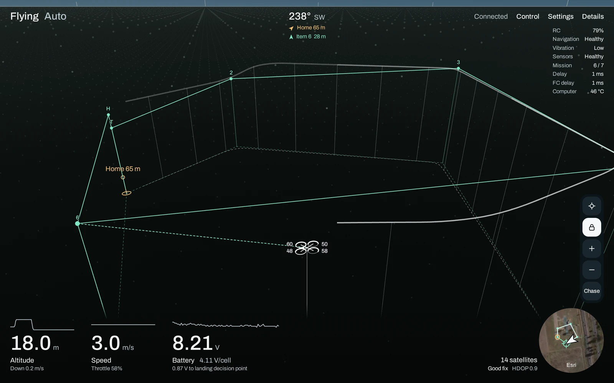
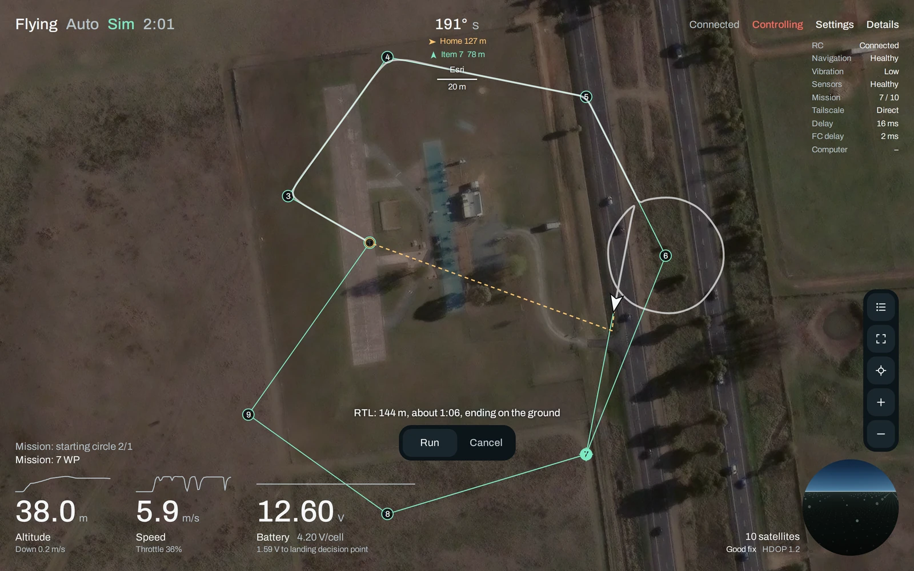

# DroneStats

[中文说明](README.zh-CN.md)

A live MAVLink dashboard for an ArduPilot multicopter, run on the companion computer and opened in any
browser. It shows the view from the aircraft or from behind it as a 3D scene drawn by the viewer's GPU,
a satellite map, the stored mission, fence and rally points, battery forecasts, link quality and the
flight controller's own checks. It is read-only until a viewer turns on execution, and then commands go
through the map: fly here, land here, return, a mission, each shown on the main page as the way it would
go before it is sent. Chinese and English.

<p align="center">
  
  
</p>

Above: the pretend flight controller in `tools/fake_fc.py` flying its sample mission over ArduPilot's
default simulator location, from behind the aircraft and on the map.

> **Safety.** With execution on, this software commands a real aircraft: it can arm it, fly it, and stop
> its motors in the air. Fly only where a mistake would hurt no one, with a transmitter in hand that can
> take over at any moment. Check any change against SITL (`tools/sitl_check.py`) before flying it. It
> comes with no warranty; see `LICENSE`.

## How it fits together

```text
flight controller (ArduCopter 4.7)
        │ UART2 (/dev/ttyS2), MAVLink 2 at 57600 baud
        ▼
mavlink-router ──── TCP 5678 ───▶ ground station, if any
        │ TCP 127.0.0.1:5678
        ▼
DroneStats (server.py) ── HTTP on 127.0.0.1:8080
        │ connections from the tailnet arrive over loopback
        ▼
Tailscale, userspace networking ──▶ a browser on any device in the tailnet
```

DroneStats is one Python process, `server.py`, whose only direct dependency is pymavlink. It connects to
mavlink-router only while a page is open, keeps the vehicle's state and up to 30 minutes of history, and
serves the page in `web/` with live updates as Server-Sent Events. Everything the page draws, the 3D view
and the route predictions included, is worked out in the viewer's browser.

## Reference environment

DroneStats is made for one setup, and deploying it means reproducing that setup. Other computers,
operating systems and airframes are not looked after.

| Part | Reference | What depends on it |
| --- | --- | --- |
| Companion computer | Orange Pi Zero 3W with 6 GB, the Allwinner A733 (`sun60iw2`) version. Many boards sold under that name are an H618 instead, with other serial ports | `board.py` reads `/proc` and `/sys`; the UART below |
| Operating system | Orange Pi's Ubuntu 26.04.1 LTS image, version 1.0.2, kernel 6.6.98-sun60iw2, systemd 259 | `install.sh` installs systemd services |
| Python | 3.14.4, the system's `python3` with `python3-venv` (3.11 or newer works) | `install.sh` makes `.venv` with it |
| Python packages | Exactly those in `requirements.txt`: pymavlink 2.4.50 and what it needs | Installed with their hashes, so every install gets the same files |
| MAVLink router | mavlink-router (upstream commit `2362c62`), the flight controller on UART2 (`/dev/ttyS2`) at 57600 baud, a TCP server on port 5678: `deploy/mavlink-router.conf` | The defaults `--mavlink 127.0.0.1:5678` and `--baud 57600` |
| Remote access | Tailscale 1.104.5 in userspace networking mode | The page listens on loopback and is still reached over the tailnet |
| Firewall | `deploy/mavlink-lan-block.service`, with iptables 1.8.11 (nf_tables) | Keeps the local network off port 5678; optional |
| Wi-Fi reading | iw 6.17 | The Wi-Fi panel; optional |
| Flight controller | ArduCopter 4.7.1 | Parameter names and units, and the route predictions |
| Airframe | Quad X (`FRAME_CLASS` 1, `FRAME_TYPE` 1), drawn at the size of a 7-inch quad | The motor gauges and the aircraft in the 3D view |
| Battery | LiPo, with the number of cells given to `install.sh --cells` | The battery forecast |

The versions are what `tools/env_report.sh` printed on the reference computer. To compare another
computer with it, run the same script there. It prints the board, the system, the Python and package
versions, the mavlink-router configuration and the Tailscale mode, and leaves out host names, addresses
and network names, so its output can be shared.

## Preparing the computer

These are the parts outside this repository that DroneStats relies on. `install.sh` does not install or
change any of them. Start from Orange Pi's Ubuntu 26.04 image for the Zero 3W.

1. **Base packages, and this repository**, whose `deploy/` folder the next steps use:

       sudo apt update
       sudo apt install git python3-venv iw
       git clone https://github.com/kiliasu/DroneStats.git ~/DroneStats

2. **The flight controller's UART, and mavlink-router.** Wire the flight controller's TELEM port to the
   40-pin header: pin 11 (UART2 TX) to its RX, pin 13 (UART2 RX) to its TX, and pin 9 to its ground.
   Power the two separately and share only ground. On the flight controller set that port to
   `SERIALn_PROTOCOL` 2 (MAVLink 2) and `SERIALn_BAUD` 57 (57600).

   The reference computer was set up with Prof. Peter Burke's
   [installmavlinkrouterorangepizero3w](https://github.com/PeterJBurke/installmavlinkrouterorangepizero3w),
   whose defaults are these values: it enables UART2 (`overlays=uart2` in `/boot/orangepiEnv.txt`),
   installs mavlink-router as a service and writes the configuration in `deploy/mavlink-router.conf`. Its
   README lists what else it changes, such as turning off Wi-Fi power saving.

       wget -O install-mavlink-router.sh https://raw.githubusercontent.com/PeterJBurke/installmavlinkrouterorangepizero3w/main/install.sh
       chmod +x install-mavlink-router.sh
       sudo ./install-mavlink-router.sh 2>&1 | tee MavlinkRouterBuildlog.txt
       sudo reboot

   To do it by hand instead, add `uart2` to the `overlays=` line in `/boot/orangepiEnv.txt`, build
   [mavlink-router](https://github.com/mavlink-router/mavlink-router) at commit `2362c62` as its README
   describes, and install `deploy/mavlink-router.conf` as `/etc/mavlink-router/main.conf`.

3. **Tailscale, in userspace networking mode.** In that mode connections from the tailnet arrive over
   loopback, which is where the page listens:

       curl -fsSL https://tailscale.com/install.sh | sh
       sudo sed -i 's/^FLAGS=.*/FLAGS="--tun=userspace-networking"/' /etc/default/tailscaled
       sudo systemctl restart tailscaled
       sudo tailscale up

4. **Optionally, the firewall unit.** mavlink-router's TCP server listens on every interface and cannot
   be told otherwise. `deploy/mavlink-lan-block.service` closes port 5678 to everything but loopback and
   `tailscale0`, so the local network cannot reach the flight controller through it:

       sudo apt install iptables
       sudo install -m 644 ~/DroneStats/deploy/mavlink-lan-block.service /etc/systemd/system/
       sudo systemctl daemon-reload
       sudo systemctl enable --now mavlink-lan-block

## Install

    cd ~/DroneStats
    ./install.sh

That makes a Python environment in `.venv`, installs the pinned packages in `requirements.txt`, and
starts a service at boot that reads MAVLink from `127.0.0.1:5678` and serves the page on
`127.0.0.1:8080`. Change either with options:

| Option | Default | |
| --- | --- | --- |
| `--mavlink HOST:PORT` | `127.0.0.1:5678` | Any MAVLink TCP endpoint: mavlink-router, MAVProxy, SITL |
| `--listen ADDR:PORT` | `127.0.0.1:8080` | `0.0.0.0:8080` to open it from the local network |
| `--allow-host NAME` | | Another name the page may be opened by, such as `drone.example.com` (repeatable) |
| `--cells N` | 2 (3 with `--sitl`) | Battery cells in series |
| `--baud N` | 57600 | Speed of the serial link to the flight controller, for the link load reading |
| `--sitl DIR` | | Also run an ArduCopter SITL built in this ArduPilot checkout, and read that |
| `--sitl-home LAT,LON,ALT,HDG` | ArduPilot's default | Where the simulated aircraft starts |
| `--sitl-instance N` | 2 | The SITL instance, which sets its ports: TCP 5760 + 10 × N |
| `--user` | | A per-user service, with no root |
| `--no-service` | | Only the environment, to start it by hand |
| `--uninstall` | | Remove the services; keep the code, `.venv` and marks |

Run it again with other options to change them. It ends by saying which of mavlink-router, `iw` and
Tailscale in userspace mode it could not find; `tools/env_report.sh` shows the rest.

## Running it

    systemctl status dronestats
    journalctl -u dronestats -f              # every command sent is in here
    sudo systemctl restart dronestats        # after editing files in web/

To update, pull and run `install.sh` again with the same options as before (`systemctl cat dronestats`
shows them). It installs the pinned packages again and restarts the service:

    cd ~/DroneStats
    git pull
    ./install.sh --cells 3                   # for example

`./install.sh --uninstall` removes the services and leaves the code, `.venv` and the marks.

Marks placed on the map are kept in `/var/lib/dronestats/marks.json` for the system service. A per-user
service keeps them under `~/.local/state/dronestats` or `~/.config/dronestats`, depending on the version
of systemd, and `server.py` started by hand keeps them in `state/` beside the code.

### Reaching the page

The default listens on this computer only. With Tailscale in userspace mode, tailnet connections arrive
over loopback, so the page is reachable from the tailnet and not from the local network. With
`--listen 0.0.0.0:8080` anything that can reach the computer can open it.

The page answers to addresses typed as numbers, to this computer's own name (with `.local` or its
tailnet domain), and to names given with `--allow-host`. Any other name is refused, which stops other
web pages from reaching it through DNS rebinding. Anyone who can open the page can turn on execution:
treat the network it is on as the security boundary. At most 8 pages can be open at once.

### A simulated aircraft

    ./install.sh --sitl ~/ardupilot

runs ArduCopter SITL as a second service (a quad X, instance 2: TCP 5780, and 5782 free for a ground
station) and points the dashboard at it. The page and its browser tab say "Sim", so it cannot be taken
for a real aircraft. SITL's own ports listen on every interface; keep them behind a firewall. Build SITL
first with `./waf configure --board sitl && ./waf copter` in the ArduPilot checkout.

## What it sends to the flight controller

Read-only by default. While someone is watching it sends only:

- `MAV_CMD_REQUEST_MESSAGE`, one copy of a message that is not already arriving, at most 10 per second
- `PARAM_REQUEST_READ`, for the settings it shows or predicts with, once per connection
- `MAV_CMD_RUN_PREARM_CHECKS`, to learn why it cannot arm, once a minute while it cannot
- `LOG_REQUEST_LIST`, when the flight controller page opens and it is disarmed. It never downloads or
  erases a log, and sends no `LOG_REQUEST_END`, which would cancel a download a ground station is running
- `MISSION_REQUEST_LIST`, `MISSION_REQUEST_INT` and `MISSION_ACK`, to read the stored mission, fence and
  rally points, one item at a time

It never changes stream rates and sends no heartbeat. With nobody watching it does not connect at all.

While someone is watching it also looks at how this computer is connected: `iw` for the Wi-Fi link, a
TCP handshake with the router to time the trip, and tailscaled's local socket to see whether devices in
use reach it directly or through a relay. All of it is optional and none of it touches the flight
controller.

## Commands

Commands need execution turned on, from the top of Details or from the Control menu. That is the one
button that has to be held: it turns execution on and opens the control panel. One connected page at a
time can hold execution. It closes when that page leaves, or after 3 minutes unused unless the aircraft
is armed. The server accepts only what is in the table in `commands.py`, sends each command once, and
refuses a command if the page has not seen live data in the last 3 seconds.

Every other button runs on a press. A command that would take the aircraft somewhere (`takeoff`, `goto`,
`land_at`, `altitude`, `mission_start`, and RTL, Smart RTL, Land or Auto once in the air) is not sent by
that press: it closes whatever it was pressed in and shows on the main page, in the 3D view and on the
map, the way it would go, where it would end and how long that would take, and Run there sends it.
`web/predict.js` works this out from the parameters the flight controller reports, following how
ArduCopter 4.7.1 flies, including the stopping distance at speed; flown against SITL it ended within a
few metres of where it said. It is an estimate, in still air. Commands that go nowhere, such as Brake,
pause, disarm and `kill`, are sent at once.

`commands.py` lists every action with its input as a JSON Schema, its risk, and the rules for when it
may run. `GET /api/commands` serves the table, and the control panel is built from it. It has no web
code, so an MCP server could offer the same actions as tools. The route preview is in the page, not the
server: `/api/exec/run` runs what it is given.

| Action | What it does | Runs only when |
| --- | --- | --- |
| `arm`, `disarm` | Motors on or off | Disarm: the flight controller says at that moment that it is on the ground |
| `mode` | Stabilize, Alt Hold, Loiter, PosHold, Guided, Auto, Circle, Brake, RTL, Smart RTL, Land | Position for the modes that fly on it, home for RTL, a mission for Auto. Away from the ground, a working transmitter with its throttle stick off the bottom for those whose height follows it: Stabilize, Alt Hold, Loiter, PosHold, Circle |
| `takeoff` | Climb straight up to a height above home | Guided, armed, on the ground, with a position, and a height above where it is now |
| `goto` | Fly in a straight line to a point within 1 km and a height above home, switching to Guided first if asked | Armed, in the air, with a position |
| `land_at`, `land_cancel` | Fly to a point and land on arrival, or call that off. The landing is given up if execution closes first | As `goto` |
| `altitude` | Change height, keeping the destination the flight controller has at that moment | Guided, armed, in the air, with a position |
| `speed`, `yaw`, `pause`, `resume` | In flight. A speed asked for in Guided holds until it leaves Guided, and a new place to fly to ends a pause | Guided or Auto, armed |
| `mission_start`, `mission_item` | Start the stored mission, or choose its next item | A mission is stored. Start: armed |
| `plan_upload`, `plan_clear` | Replace or erase the mission, fence or rally points | Disarmed |
| `fence_enable` | Turn the fence on or off | On: not in the air with the aircraft already outside it |
| `set_home`, `param_set` | Make the present position or a given place home, or write one of a few flight limits | Disarmed |
| `calibrate`, `motor_test` | Gyros, barometer, level; spin one motor, by its number on a quad X, at up to 30% for up to 5 s | Disarmed, on the ground. Motor test: a quad X |
| `reboot` | Restart the flight controller | Disarmed |
| `kill` | Stop the motors at once, even in the air | Armed |

Every reply says what the flight controller answered, whether the telemetry came to show the effect,
and anything it said meanwhile, which is how it explains a refusal. Every attempt goes in a record shown
in the panel, and in the service's journal.

An uploaded plan is checked first, read back afterwards and compared. ArduPilot overwrites a stored
mission as the items arrive, so an interrupted upload can leave part of it behind; the read-back puts
what is really there on the page. Heights in a plan must be above home.

Marks placed on the map are not commands: `POST /api/marks` changes them without execution, every viewer
sees them, and they are kept in the service's state directory.

### How the flight controller flies them

Read from the ArduCopter 4.7.1 source and then flown in its simulator by `tools/sitl_check.py`, so that
what a button does is what it says:

- Every height is above home, not above the ground under the aircraft. `takeoff` to 5 m on ground that
  stands 6 m above home is refused, by the server with the reason and by the flight controller without.
- `goto`, `land_at` and `altitude` fly one straight line to the place and height asked for. Going down or
  up on the way, the aircraft does both at once and arrives at both together, slowed across so that the
  climb or descent stays within `WP_SPD_UP` or `WP_SPD_DN`; it does not change height first and then
  fly level. The preview draws that line and counts the slower of the two.
- Guided keeps a pause across a new destination, and starts its first destination after a takeoff or a
  change of mode at `WP_SPD` again, whatever speed was asked for. Left alone, a `goto` after a `pause`
  would be accepted and not flown, and one after `speed` would fly faster than asked. So after each new
  destination the server ends the pause and sends the speed again. It forgets the speed when the
  aircraft leaves Guided, as the flight controller does.
- `altitude` asks the flight controller where it is going at that moment. What it reported a few
  seconds earlier may be a mission's waypoint or the way home, from a mode it has since left.
- The motor test takes a place in the order the test goes round in, clockwise from the front right, not
  a motor's number. The server sends the place of the motor asked for, so that motor 2 turns the motor
  the page calls 2. It knows this only for a quad X and refuses any other frame.
- A landing on arrival is the server's doing: it watches the aircraft arrive and then changes the mode
  to Land. It needs a page holding execution for that, and gives the landing up if execution closes,
  the mode changes or ten minutes pass: the aircraft then holds in Guided at the place.
- `set_home` at a place on the map keeps the altitude home already has, since the page does not know
  the height of the ground there. Heights stay measured from the old home's level.

## The page

- Everything on the map can be used directly. A waypoint, a rally point, a mark, home, the aircraft or
  the fence opens a card when hovered over or tapped, and anywhere else on the map opens one for that
  place. The next tap on bare map closes it. Cards hold what is near at hand: fly here, land here, face
  this way, make this home, go to this item, take off.
- Missions are edited as a draft in the browser until written: add waypoints, loiters, circles, landings,
  rally points and marks, drag them, pull out a point between two, and import or export `.waypoints`
  and `.plan` files.
- Each rotor, on the sight and from behind, is a gauge of its motor's output, amber from 75% and red
  from 90%. The flight path is a broad see-through band; lines that measure or plan stay thin.
- Settings: flight path, distance rings, imagery, stored plan, marks, the size of the aircraft symbol,
  language. Keys: V view, M map, L lock, R reset, F fit, P mission list, Delete the open waypoint, + and -.

## Troubleshooting

| What you see | What it means | What to check |
| --- | --- | --- |
| "Cannot reach the MAVLink router" | Nothing accepts a TCP connection on `--mavlink` | `systemctl status mavlink-router`, and that `TcpServerPort` in its configuration is that port |
| "Waiting for flight controller" | The router answers, but no autopilot heartbeat comes through it | The UART wiring (TX to RX), `overlays=uart2`, `Device` and `Baud` in the router's configuration, `SERIALn_PROTOCOL` and `SERIALn_BAUD` on the flight controller |
| "Link lost" | Heartbeats stopped for 3 seconds | The flight controller's power and the cable |
| A blank page, status 421 | The page was opened by a name it does not answer to | Open it by its address, this computer's name or its tailnet name, or add the name with `--allow-host` |
| Unreachable from the tailnet | Tailscale is not in userspace mode, or not running | `tools/env_report.sh` shows the Tailscale mode; see step 3 above |
| No satellite imagery | The viewer's browser fetches the imagery itself | The device the page is open on needs internet access |
| No Wi-Fi reading | `iw` is missing, or this computer has no Wi-Fi | `sudo apt install iw` |
| The service does not start | | `journalctl -u dronestats -e` |

## Development

    ./install.sh --no-service
    .venv/bin/python -m unittest discover -s tests

    .venv/bin/python tools/fake_fc.py --port 15678 --scenario flight
    .venv/bin/python server.py --listen 127.0.0.1:18080 --mavlink 127.0.0.1:15678

Scenarios are `bench`, `ready`, `armed`, `flight`, `low` and `rclost`. `--quiet` sends only heartbeats,
like a link with no ground station. Add `?at=2026-11-05T00:50:00Z` to the page address to preview the
sky at another time, and `?q=1` to keep full resolution on a slow GPU.

The pretend flight controller was written from the same understanding as the code, so it cannot catch a
misunderstanding of the firmware. For that, run the flight check against SITL:

    .venv/bin/python tools/sitl_check.py --mavlink <host>:5760

It flies the simulator, so use the same firmware version as the aircraft. Before sending anything it asks
for `SIM_SPEEDUP`, a setting only simulators have, and stops if there is no answer.

Parameter names follow ArduCopter 4.7, which moved several from centimetres to metres. The aircraft is
drawn at the size set by `ARM` and `ROTOR` in `web/scene.js` (a 7-inch quad). Battery reference points
per cell are in `web/shared.js`.

Python packages are named in `requirements.in` and pinned, with their hashes, in `requirements.txt`. To
move to newer versions, regenerate it with [uv](https://docs.astral.sh/uv/), then run the tests and the
SITL check before deploying it:

    uv pip compile requirements.in --universal --python-version 3.11 --generate-hashes -o requirements.txt

## Files

- `server.py`: web server, live updates, command gate
- `telemetry.py`: MAVLink link, state, and up to 30 minutes of history while someone is watching
- `commands.py`: every action that can be asked of the flight controller, and the rules for each
- `plans.py`: reading and writing the stored mission, fence and rally points
- `marks.py`: places marked on the map
- `wire.py`: the MAVLink dialect and this service's IDs, the one place that names the library
- `board.py`, `network.py`: health of this computer and how it is connected
- `web/`: the page. `app.js` runs it, `scene.js` the 3D view, `map.js` the map, `mapui.js` the cards and
  the mission list, `control.js` the control panel, `predict.js` the way a command would go, `plan.js`
  the shapes of what is stored and ground station files, `pages.js` the expanded views, `shared.js` the
  battery forecast, pre-flight checks and flight path
- `install.sh`: the Python environment and the services
- `requirements.in`, `requirements.txt`: the Python packages, and those pinned with their hashes
- `deploy/`: unit templates for `install.sh`, the reference mavlink-router configuration, and the
  optional firewall unit
- `tools/fake_fc.py`: a pretend flight controller for development and tests
- `tools/sitl_check.py`: flies ArduPilot SITL through every action, to check them against real firmware
- `tools/env_report.sh`: what a computer has of the reference environment
- `tests/`: end-to-end tests against the pretend flight controller
- `docs/screenshots/`: the pictures at the top of the READMEs

## Credits

mavlink-router on the reference computer, and the UART it uses, were set up with Prof. Peter Burke's
[installmavlinkrouterorangepizero3w](https://github.com/PeterJBurke/installmavlinkrouterorangepizero3w);
the wiring in `deploy/mavlink-router.conf` follows its README. Map imagery is Esri World Imagery,
requested by the viewer's browser for the aircraft's position; check Esri's terms before relying on it. The Archivo font is under the SIL Open Font License. Built on
[pymavlink](https://github.com/ArduPilot/pymavlink).

## License

MIT, see `LICENSE`.
