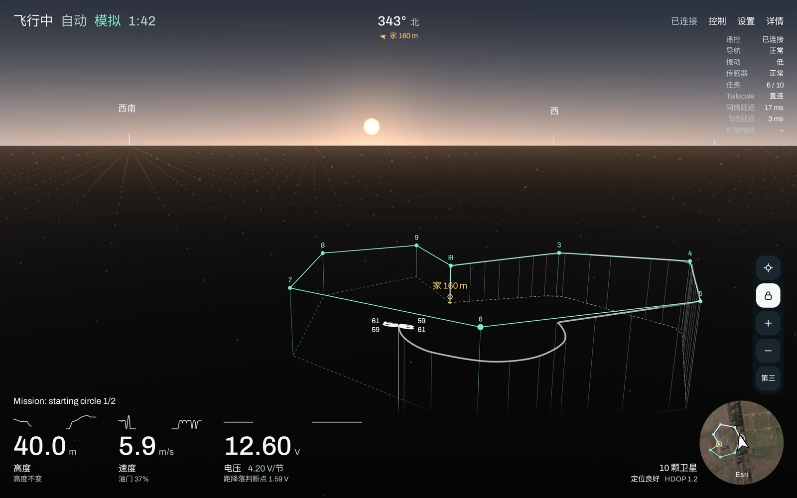
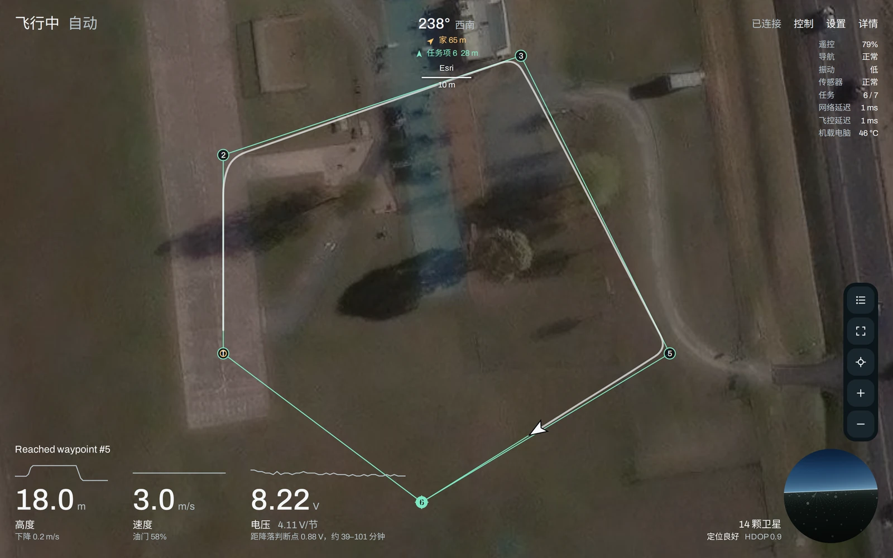

# DroneStats

[English](README.md)

一个运行在机载电脑上的 ArduPilot 多旋翼实时 MAVLink 仪表盘，用任意浏览器打开。它用观看者的 GPU 绘制机上视角或机后视角的 3D 场景，并显示卫星地图、飞控中存储的任务、围栏和集结点、电池预测、链路质量以及飞控自身的检查结果。默认只读；观看者开启执行后，可以在地图上直接下达指令：飞往、降落、返航、执行任务。每条指令发送前，先在主页面上显示它将飞行的路线。界面支持中文和英文。

<p align="center">
  
  
</p>

上图为 `tools/fake_fc.py` 中的模拟飞控在 ArduPilot 默认模拟地点执行示例任务时，机后视角和地图上的样子。

> **安全提示**：开启执行后，本软件会控制一架真实的飞行器：它能解锁、飞行，也能在空中停桨。只在出错也不会伤到人的地方飞行，并始终手持能随时接管的遥控器。任何改动都应先用 SITL（`tools/sitl_check.py`）验证再上机。本软件不提供任何担保，见 `LICENSE`。

## 整体结构

```text
飞控（ArduCopter 4.7）
        │ UART2（/dev/ttyS2），MAVLink 2，57600 波特
        ▼
mavlink-router ──── TCP 5678 ───▶ 地面站（如有）
        │ TCP 127.0.0.1:5678
        ▼
DroneStats（server.py）── HTTP，监听 127.0.0.1:8080
        │ 来自 tailnet 的连接经回环地址到达
        ▼
Tailscale（userspace networking 模式）──▶ tailnet 中任意设备上的浏览器
```

DroneStats 是一个 Python 进程 `server.py`，唯一的直接依赖是 pymavlink。它只在有页面打开时才连接 mavlink-router，保存飞行器状态和最多 30 分钟的历史，并以 Server-Sent Events 实时推送 `web/` 中的页面数据。页面上画出的一切，包括 3D 视图和航线预测，都在观看者的浏览器里计算。

## 参考环境

DroneStats 针对一套固定的环境编写，部署就是复现这套环境。其他电脑、操作系统和机架不在维护范围内。

| 组成部分 | 参考配置 | 依赖它的部分 |
| --- | --- | --- |
| 机载电脑 | Orange Pi Zero 3W，6 GB，全志 A733（`sun60iw2`）版本。很多同名板子用的是 H618，串口也不同 | `board.py` 读取 `/proc` 和 `/sys`；下面的 UART |
| 操作系统 | Orange Pi 的 Ubuntu 26.04.1 LTS 镜像 1.0.2 版，内核 6.6.98-sun60iw2，systemd 259 | `install.sh` 安装 systemd 服务 |
| Python | 3.14.4，即系统自带的 `python3` 加 `python3-venv`（3.11 或更新均可） | `install.sh` 用它创建 `.venv` |
| Python 包 | 与 `requirements.txt` 完全一致：pymavlink 2.4.50 及其依赖 | 按哈希安装，每次安装得到相同的文件 |
| MAVLink 路由 | mavlink-router（上游提交 `2362c62`）：飞控接在 UART2（`/dev/ttyS2`）上，57600 波特；TCP 服务端口 5678；配置见 `deploy/mavlink-router.conf` | 默认参数 `--mavlink 127.0.0.1:5678` 和 `--baud 57600` |
| 远程访问 | Tailscale 1.104.5，userspace networking 模式 | 页面只监听回环地址，仍可经 tailnet 访问 |
| 防火墙 | `deploy/mavlink-lan-block.service`，iptables 1.8.11（nf_tables） | 不让局域网访问 5678 端口；可选 |
| Wi-Fi 读数 | iw 6.17 | Wi-Fi 面板；可选 |
| 飞控 | ArduCopter 4.7.1 | 参数名和单位，以及航线预测 |
| 机架 | 四旋翼 X 型（`FRAME_CLASS` 1，`FRAME_TYPE` 1），按 7 寸机的尺寸绘制 | 电机读数和 3D 视图中的飞行器 |
| 电池 | 锂聚合物（LiPo），节数由 `install.sh --cells` 指定 | 电池预测 |

表中的版本是 `tools/env_report.sh` 在参考机上的输出。要把另一台电脑与之比较，在那台电脑上运行同一个脚本。它会输出主板型号、系统、Python 和各个包的版本、mavlink-router 的配置以及 Tailscale 的模式，并略去主机名、地址和网络名称，输出可以直接分享。

## 准备机载电脑

以下是 DroneStats 依赖的、位于本仓库之外的部分。`install.sh` 不会安装或修改其中任何一项。请从 Orange Pi 为 Zero 3W 提供的 Ubuntu 26.04 镜像开始。

1. **基础软件包和本仓库**（后面的步骤要用到其中的 `deploy/` 目录）：

       sudo apt update
       sudo apt install git python3-venv iw
       git clone <本仓库地址> ~/DroneStats

2. **连接飞控的 UART 和 mavlink-router**。把飞控的 TELEM 口接到 40 针排针：11 脚（UART2 TX）接飞控 RX，13 脚（UART2 RX）接飞控 TX，9 脚接飞控 GND。两者分别供电，只共地。在飞控上把对应端口设为 `SERIALn_PROTOCOL` 2（MAVLink 2）、`SERIALn_BAUD` 57（57600）。

   参考机用的是 Peter Burke 教授的 [installmavlinkrouterorangepizero3w](https://github.com/PeterJBurke/installmavlinkrouterorangepizero3w)，它的默认值正是上述配置：启用 UART2（`/boot/orangepiEnv.txt` 中的 `overlays=uart2`），把 mavlink-router 安装为服务，并写入与 `deploy/mavlink-router.conf` 相同的配置。它还会做其他改动，例如关闭 Wi-Fi 省电，详见其 README。

       wget -O install-mavlink-router.sh https://raw.githubusercontent.com/PeterJBurke/installmavlinkrouterorangepizero3w/main/install.sh
       chmod +x install-mavlink-router.sh
       sudo ./install-mavlink-router.sh 2>&1 | tee MavlinkRouterBuildlog.txt
       sudo reboot

   如果想手动完成：在 `/boot/orangepiEnv.txt` 的 `overlays=` 一行加入 `uart2`，按 [mavlink-router](https://github.com/mavlink-router/mavlink-router) 的 README 在提交 `2362c62` 上编译安装，再把 `deploy/mavlink-router.conf` 安装为 `/etc/mavlink-router/main.conf`。

3. **Tailscale，userspace networking 模式**。在这种模式下，来自 tailnet 的连接经回环地址到达，而页面正监听在那里：

       curl -fsSL https://tailscale.com/install.sh | sh
       sudo sed -i 's/^FLAGS=.*/FLAGS="--tun=userspace-networking"/' /etc/default/tailscaled
       sudo systemctl restart tailscaled
       sudo tailscale up

4. **（可选）防火墙单元**。mavlink-router 的 TCP 服务监听所有网卡，且无法更改。`deploy/mavlink-lan-block.service` 让 5678 端口只对回环和 `tailscale0` 开放，局域网中的设备就无法借它访问飞控：

       sudo apt install iptables
       sudo install -m 644 ~/DroneStats/deploy/mavlink-lan-block.service /etc/systemd/system/
       sudo systemctl daemon-reload
       sudo systemctl enable --now mavlink-lan-block

## 安装

    cd ~/DroneStats
    ./install.sh

它会在 `.venv` 中创建 Python 环境，安装 `requirements.txt` 中锁定的包，并启动一个开机自启的服务：从 `127.0.0.1:5678` 读取 MAVLink，在 `127.0.0.1:8080` 提供页面。可用以下选项修改：

| 选项 | 默认值 | 说明 |
| --- | --- | --- |
| `--mavlink HOST:PORT` | `127.0.0.1:5678` | 任意 MAVLink TCP 端点：mavlink-router、MAVProxy、SITL |
| `--listen ADDR:PORT` | `127.0.0.1:8080` | 设为 `0.0.0.0:8080` 可从局域网打开 |
| `--allow-host NAME` | | 允许用来打开页面的其他名称，例如 `drone.example.com`（可重复） |
| `--cells N` | 2（使用 `--sitl` 时为 3） | 电池串联节数 |
| `--baud N` | 57600 | 与飞控之间串口的速率，用于计算链路负载 |
| `--sitl DIR` | | 同时运行在该 ArduPilot 源码目录中编译的 ArduCopter SITL，并读取它 |
| `--sitl-home LAT,LON,ALT,HDG` | ArduPilot 默认值 | 模拟飞行器的起始位置 |
| `--sitl-instance N` | 2 | SITL 实例号，决定其端口：TCP 5760 + 10 × N |
| `--user` | | 安装为当前用户的服务，无需 root |
| `--no-service` | | 只创建 Python 环境，手动启动 |
| `--uninstall` | | 删除服务；保留代码、`.venv` 和标记 |

用其他选项再次运行即可修改设置。脚本最后会指出没有找到 mavlink-router、`iw` 或 userspace 模式的 Tailscale 中的哪些；其余情况用 `tools/env_report.sh` 查看。

## 运行与维护

    systemctl status dronestats
    journalctl -u dronestats -f              # 每条发出的指令都记录在这里
    sudo systemctl restart dronestats        # 修改 web/ 中的文件后

更新时，拉取代码并用与之前相同的选项重新运行 `install.sh`（`systemctl cat dronestats` 可以看到当前选项）。它会重新安装锁定的包并重启服务：

    cd ~/DroneStats
    git pull
    ./install.sh --cells 3                   # 仅为示例

`./install.sh --uninstall` 删除服务，保留代码、`.venv` 和标记。

地图上放置的标记，系统服务保存在 `/var/lib/dronestats/marks.json`；用户服务视 systemd 版本保存在 `~/.local/state/dronestats` 或 `~/.config/dronestats`；手动启动的 `server.py` 保存在代码旁的 `state/` 目录。

### 访问页面

默认只监听本机。Tailscale 处于 userspace 模式时，来自 tailnet 的连接经回环地址到达，所以页面可以从 tailnet 访问，而不能从局域网访问。使用 `--listen 0.0.0.0:8080` 时，任何能访问这台电脑的设备都能打开页面。

页面只响应以数字形式输入的地址、本机的主机名（可带 `.local` 或 tailnet 域名），以及用 `--allow-host` 指定的名称。其他名称一律拒绝，以防其他网页通过 DNS 重绑定访问它。任何能打开页面的人都能开启执行，因此页面所在的网络就是安全边界。同时最多可以打开 8 个页面。

### 模拟飞行器

    ./install.sh --sitl ~/ardupilot

会把 ArduCopter SITL 作为第二个服务运行（四旋翼 X 型，实例 2：TCP 5780，另有 5782 留给地面站），并让仪表盘读取它。页面和浏览器标签页会显示“模拟”，不会被误认为真实飞行器。SITL 自己的端口监听所有网卡，请用防火墙保护。需要先在 ArduPilot 源码目录中用 `./waf configure --board sitl && ./waf copter` 编译 SITL。

## 发送给飞控的内容

默认只读。有人观看时，它只发送：

- `MAV_CMD_REQUEST_MESSAGE`：请求一份尚未自行到达的消息，每秒最多 10 次
- `PARAM_REQUEST_READ`：读取页面显示或预测要用的参数，每次连接一次
- `MAV_CMD_RUN_PREARM_CHECKS`：在无法解锁时了解原因，每分钟一次
- `LOG_REQUEST_LIST`：在打开飞控页面且未解锁时发送。它从不下载或删除日志，也不发送 `LOG_REQUEST_END`，因为那会取消地面站正在进行的下载
- `MISSION_REQUEST_LIST`、`MISSION_REQUEST_INT` 和 `MISSION_ACK`：逐项读取存储的任务、围栏和集结点

它从不修改数据流速率，也不发送心跳。没有人观看时，它根本不连接。

有人观看时，它还会查看这台电脑的联网情况：用 `iw` 读取 Wi-Fi 链路，与路由器做一次 TCP 握手来测量往返时间，并通过 tailscaled 的本地 socket 查看正在使用的设备是直连还是经中继到达。这些都是可选的，也都不涉及飞控。

## 指令

指令需要先开启执行，入口在“详情”顶部或“控制”菜单中。这是唯一需要按住的按钮：它开启执行并打开控制面板。同一时间只有一个已连接的页面能持有执行权。该页面离开时执行即关闭；未解锁时，闲置 3 分钟也会关闭。服务器只接受 `commands.py` 表中的指令，每条只发送一次；如果页面在最近 3 秒内没有看到实时数据，指令会被拒绝。

其他按钮点按即生效。会让飞行器移动到别处的指令（`takeoff`、`goto`、`land_at`、`altitude`、`mission_start`，以及在空中时的 RTL、Smart RTL、Land 或 Auto）不会在点按时发出：它会关闭所在的面板，在主页面的 3D 视图和地图上显示将要飞行的路线、终点和所需时间，在那里点“执行”才会发送。`web/predict.js` 根据飞控报告的参数，按 ArduCopter 4.7.1 的飞行方式计算这些结果，包括高速时的制动距离；在 SITL 上实测，终点与预测相差不到几米。这只是无风条件下的估计。不会去往别处的指令，如刹车、暂停、上锁和 `kill`，会立即发送。

`commands.py` 列出了每个动作的 JSON Schema 输入、风险等级和执行条件。`GET /api/commands` 提供这张表，控制面板据此生成。它不含网页代码，所以 MCP 服务器也可以把同样的动作作为工具提供。航线预览在页面里而不在服务器上：`/api/exec/run` 收到什么就执行什么。

| 动作 | 作用 | 仅在以下条件下执行 |
| --- | --- | --- |
| `arm`、`disarm` | 解锁或上锁电机 | 上锁：飞控在那一刻报告已在地面 |
| `mode` | Stabilize、Alt Hold、Loiter、PosHold、Guided、Auto、Circle、Brake、RTL、Smart RTL、Land | 依赖位置的模式需要有定位，RTL 需要家点，Auto 需要任务。离地时，高度跟随油门杆的模式（Stabilize、Alt Hold、Loiter、PosHold、Circle）需要遥控器工作正常且油门杆不在最低 |
| `takeoff` | 爬升到指定高度 | Guided 模式、已解锁、在地面、有定位 |
| `goto` | 飞往 1 km 内的一点，可按需先切换到 Guided | 已解锁、在空中、有定位 |
| `land_at`、`land_cancel` | 飞往一点并在到达后降落，或取消 | 同 `goto` |
| `altitude` | 改变高度，保持目的地 | Guided 模式、已解锁、在空中、有定位 |
| `speed`、`yaw`、`pause`、`resume` | 飞行中调整 | Guided 或 Auto 模式、已解锁 |
| `mission_start`、`mission_item` | 开始执行存储的任务，或选择下一个任务项 | 已存储任务。开始执行还需已解锁 |
| `plan_upload`、`plan_clear` | 替换或清除任务、围栏或集结点 | 未解锁 |
| `fence_enable` | 开启或关闭围栏 | 任何时候 |
| `set_home`、`param_set` | 把当前位置或指定位置设为家点，或修改少数几项飞行限制 | 未解锁 |
| `calibrate`、`motor_test` | 校准陀螺仪、气压计、水平；以最多 30% 的油门转动单个电机最多 5 秒 | 未解锁、在地面 |
| `reboot` | 重启飞控 | 未解锁 |
| `kill` | 立即停止电机，即使在空中 | 已解锁 |

每次回复都会说明飞控的应答、遥测是否显示出效果，以及期间飞控说了什么，飞控就是这样解释拒绝原因的。每次尝试都会记录在面板中，也会写入服务日志。

上传的计划会先检查，上传后再读回比对。ArduPilot 会在任务项陆续到达时覆盖已存储的任务，因此中断的上传可能留下一部分；读回后页面显示的是飞控中真正存储的内容。计划中的高度必须高于家点。

地图上的标记不是指令：`POST /api/marks` 无需开启执行即可修改它们，所有观看者都能看到，并保存在服务的状态目录中。

## 页面

- 地图上的一切都可以直接操作。悬停或点按航点、集结点、标记、家点、飞行器或围栏会打开对应的卡片，点按地图其他位置会打开该处的卡片，再点一次空白地图即关闭。卡片中是就近可用的操作：飞往这里、在此降落、朝向这里、设为家点、前往此任务项、起飞。
- 任务在写入飞控前作为草稿在浏览器中编辑：添加航点、盘旋、绕圈、降落、集结点和标记，拖动它们，从两点之间拉出新点，并可导入或导出 `.waypoints` 和 `.plan` 文件。
- 准星上和机后视角中的每个旋翼都是对应电机输出的读数，75% 起显示琥珀色，90% 起显示红色。飞行轨迹是一条宽而半透明的带；测量或规划用的线保持纤细。
- 设置：轨迹、距离环、卫星图、已存储的计划、标记、飞行器符号大小、语言。快捷键：V 视角，M 地图，L 锁定，R 复位，F 适应，P 任务列表，Delete 删除打开的航点，+ 和 - 缩放。

## 排错

| 看到的现象 | 含义 | 检查什么 |
| --- | --- | --- |
| “无法连接 MAVLink 路由” | `--mavlink` 上没有程序接受 TCP 连接 | `systemctl status mavlink-router`，以及其配置中的 `TcpServerPort` 是否为该端口 |
| “等待飞控” | 路由有应答，但没有收到飞控的心跳 | UART 接线（TX 接 RX）、`overlays=uart2`、路由配置中的 `Device` 和 `Baud`、飞控上的 `SERIALn_PROTOCOL` 和 `SERIALn_BAUD` |
| “连接中断” | 已有 3 秒没有心跳 | 飞控供电和连线 |
| 空白页面，状态码 421 | 用页面不认识的名称打开了它 | 用地址、本机主机名或 tailnet 名称打开，或用 `--allow-host` 加入该名称 |
| 从 tailnet 无法访问 | Tailscale 未运行，或不是 userspace 模式 | `tools/env_report.sh` 会显示 Tailscale 的模式；见上文第 3 步 |
| 没有卫星图 | 卫星图由观看者的浏览器自行获取 | 打开页面的设备需要能访问互联网 |
| 没有 Wi-Fi 读数 | 没有安装 `iw`，或这台电脑没有 Wi-Fi | `sudo apt install iw` |
| 服务无法启动 | | `journalctl -u dronestats -e` |

## 开发

    ./install.sh --no-service
    .venv/bin/python -m unittest discover -s tests

    .venv/bin/python tools/fake_fc.py --port 15678 --scenario flight
    .venv/bin/python server.py --listen 127.0.0.1:18080 --mavlink 127.0.0.1:15678

场景有 `bench`、`ready`、`armed`、`flight`、`low` 和 `rclost`。`--quiet` 只发送心跳，模拟没有地面站的链路。在页面地址后加 `?at=2026-11-05T00:50:00Z` 可以预览另一时刻的天空，加 `?q=1` 可以在较慢的 GPU 上保持全分辨率。

模拟飞控与代码出自同一套理解，因此发现不了对固件的误解。为此，请对 SITL 运行飞行检查：

    .venv/bin/python tools/sitl_check.py --mavlink <host>:5760

它会让模拟器真正飞行，所以请使用与飞行器相同的固件版本。发送任何指令前，它会先读取只有模拟器才有的参数 `SIM_SPEEDUP`，读不到就停止。

参数名遵循 ArduCopter 4.7，该版本把若干参数从厘米改为米。飞行器按 `web/scene.js` 中 `ARM` 和 `ROTOR` 设定的尺寸绘制（7 寸四旋翼）。每节电池的参考电压点在 `web/shared.js` 中。

Python 包的名称写在 `requirements.in` 中，连同哈希锁定在 `requirements.txt` 中。要升级到新版本，用 [uv](https://docs.astral.sh/uv/) 重新生成，然后先运行测试和 SITL 检查，再部署：

    uv pip compile requirements.in --universal --python-version 3.11 --generate-hashes -o requirements.txt

## 文件

- `server.py`：Web 服务器、实时推送、指令关卡
- `telemetry.py`：MAVLink 链路、状态，以及有人观看时最多 30 分钟的历史
- `commands.py`：可以向飞控请求的每个动作及其规则
- `plans.py`：读写存储的任务、围栏和集结点
- `marks.py`：地图上的标记
- `wire.py`：MAVLink 方言和本服务的 ID，是唯一引用该库的地方
- `board.py`、`network.py`：这台电脑的运行状况和联网情况
- `web/`：页面。`app.js` 负责运行，`scene.js` 是 3D 视图，`map.js` 是地图，`mapui.js` 是卡片和任务列表，`control.js` 是控制面板，`predict.js` 预测指令的航线，`plan.js` 处理存储内容的形状和地面站文件，`pages.js` 是展开视图，`shared.js` 是电池预测、起飞前检查和飞行轨迹
- `install.sh`：Python 环境和服务
- `requirements.in`、`requirements.txt`：Python 包，以及连同哈希锁定的版本
- `deploy/`：`install.sh` 使用的单元模板、参考机的 mavlink-router 配置，以及可选的防火墙单元
- `tools/fake_fc.py`：用于开发和测试的模拟飞控
- `tools/sitl_check.py`：让 ArduPilot SITL 执行每个动作，用真实固件检验它们
- `tools/env_report.sh`：一台电脑与参考环境相符的情况
- `tests/`：针对模拟飞控的端到端测试
- `docs/screenshots/`：README 开头的截图

## 致谢

参考机上的 mavlink-router 及其使用的 UART 由 Peter Burke 教授的 [installmavlinkrouterorangepizero3w](https://github.com/PeterJBurke/installmavlinkrouterorangepizero3w) 安装和配置，`deploy/mavlink-router.conf` 中的接线说明也出自其 README。卫星图来自 Esri World Imagery，由观看者的浏览器按飞行器位置请求；使用前请查阅 Esri 的条款。Archivo 字体采用 SIL Open Font License。基于 [pymavlink](https://github.com/ArduPilot/pymavlink) 构建。

## 许可证

MIT，见 `LICENSE`。
